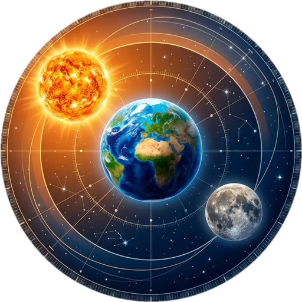

<p align="center">
  
</p>

# ☀️ Astronomical Sun & Moon Card for Home Assistant

[](https://my.home-assistant.io/redirect/hacs_repository/?owner=adromir&repository=ha-astronomical-sun-moon-card&category=plugin)
[](https://ko-fi.com/adromir)
[](https://github.com/hacs/default)
[](https://github.com/adromir/ha-astronomical-sun-moon-card/releases)
[](LICENSE)
[](https://github.com/adromir/ha-astronomical-sun-moon-card)

A modern, highly tactile Lovelace Custom Card for Home Assistant that visualizes real-time celestial mechanics: the sun's trajectory across the sky dome, solar elevation & azimuth, day/golden-hour/dusk/night atmospheric transitions, and mathematically precise lunar phases with crater illumination.

---

## ✨ Features

- **Real-Time Celestial Sky Dome**:
  - Parabolic solar trajectory arc from East (90°) through South (180°) to West (270°).
  - Sub-horizon night arc tracing solar movement underneath the earth.
  - Live sun object with radiant glow corona and real-time elevation readout.
- **Dynamic Atmospheric Backdrop**:
  - Seamlessly transforms its sky gradient based on real solar elevation:
    - **Daylight** (> 6°): Crisp daylight sky blue.
    - **Golden Hour** (0° – 6°): Warm sunset and sunrise orange & amber.
    - **Civil Twilight / Dusk** (-6° – 0°): Deep magenta, indigo, and evening dusk.
    - **Nautical Twilight** (-12° – -6°): Deep navy twilight.
    - **Astronomical Night** (< -12°): Cosmic midnight black with shimmering starfield!
- **Real Local Night Sky & Constellations (v1.3.0)**:
  - Dynamically calculates the **Local Sidereal Time (LST)** from your observer coordinates and projects the actual visible night sky.
  - Features ~50 navigational stars (Ursa Major, Orion, Cassiopeia, Summer Triangle, etc.) with magnitude scaling and twinkling animations.
  - Subtle dashed constellation outline lines connect key asterisms.
- **Animated Meteor Showers & Shooting Stars (v1.3.0)**:
  - Tracks 8 major annual meteor showers (Perseids, Geminids, Leonids, Quadrantids, etc.).
  - Animated shooting star streaks streak across the night sky dome, increasing in frequency near shower peaks.
- **Animated Aurora Borealis & Aurora Australis (v1.3.0)**:
  - Hemisphere-aware: Renders Aurora Borealis (Northern Hemisphere) or Aurora Australis (Southern Hemisphere).
  - Luminous, undulating emerald-green and magenta glowing wave curtains above the horizon.
  - Auto-integrates with Home Assistant's `aurora` integration (`binary_sensor.aurora_visibility_*`) or testable anytime via demo mode.
- **Compact Astronomical Events Status Ribbon (v1.3.0)**:
  - Sleek ribbon directly below the celestial dome showing upcoming solstices, equinoxes, meteor shower peaks, and eclipses.
- **Photorealistic SVG Lunar Phases**:
  - Accurate mathematical lunar terminator calculated from the synodic cycle.
  - Renders true-to-life crescent, quarter, gibbous, and full moon shapes with subtle lunar crater shading.
  - Live illumination percentage (0–100%) and moon age in days.
  - Countdown to next Full Moon and next New Moon.
- **Celestial Milestones**:
  - Exact times for Sunrise, Solar Noon (peak altitude), and Sunset.
  - Compass heading with exact azimuth degrees and cardinal direction (e.g. `184° SSW`).
- **Flexible View Modes**:
  - `combined`: Shows both Sun and Moon celestial data.
  - `sun_only`: Focuses purely on solar trajectory, milestones, and daytime metrics.
  - `moon_only`: Dedicated lunar calendar with illumination, phase details, and night sky.
  - Interactive on-card view switcher pills.
- **Visual GUI Lovelace Card Editor**:
  - Full graphical editor support in Home Assistant (`astronomical-sun-moon-card-editor`).
- **100% Theme Compliant**:
  - Uses native Home Assistant CSS tokens (`--ha-card-background`, `--primary-text-color`, `--divider-color`). Zero dependencies.

---

## 📦 Installation

### Option 1: Via HACS (Recommended)

1. Ensure [HACS](https://hacs.xyz/) is installed.
2. Click the badge below:

[](https://my.home-assistant.io/redirect/hacs_repository/?owner=adromir&repository=ha-astronomical-sun-moon-card&category=plugin)

3. Alternatively, in Home Assistant go to **HACS** > **Frontend** > **Three dots (top right)** > **Custom repositories**.
4. Add repository URL: `https://github.com/adromir/ha-astronomical-sun-moon-card`
5. Category: **Dashboard** / **Plugin**.
6. Click **Install**.
7. Refresh your browser cache.

### Option 2: Manual Installation

1. Download `dist/astronomical-sun-moon-card.js` and the `dist/assets/` folder from the [latest release](https://github.com/adromir/ha-astronomical-sun-moon-card/releases).
2. Upload `astronomical-sun-moon-card.js` into your `<config>/www/` directory.
3. In Home Assistant, go to **Settings** > **Dashboards** > **Three dots (top right)** > **Resources**.
4. Add resource:
   - URL: `/local/astronomical-sun-moon-card.js?v=1.3.0`
   - Type: `JavaScript Module`

---

## ⚙️ Configuration

### Graphical Editor

When editing your dashboard, click **Add Card**, search for **Astronomical Sun & Moon Card**, and customize settings directly in the visual GUI editor.

### Recommended Companion: Home Assistant Moon Integration

For accurate local lunar data and synchronization with Home Assistant's official astronomical calendar, we strongly recommend adding the built-in **Moon** integration (`sensor.moon_phase`):

[](https://my.home-assistant.io/redirect/config_flow_start/?domain=moon)

*The card automatically detects and prioritizes `sensor.moon_phase` or `sensor.moon` if present on your system.*

### Built-in Celestial Textures (Alpha Transparency)

Starting with **v1.2.0** and updated in **v1.3.0**, high-resolution photorealistic textures for the **Moon**, **Sun** (with solar corona flares), and **Earth horizon** are bundled natively as self-contained Base64 Data URIs with full alpha transparency.

> [!TIP]
> **No extra moon phase images required**: Thanks to dynamic mathematical SVG terminator masking, every single lunar phase (including continuous fractional values) is calculated and shaded live in vector space directly onto the full-disc texture — complete with earthshine (unlit side at 20% opacity) and glowing crater highlights!

### YAML Example

```yaml
type: custom:astronomical-sun-moon-card
title: "Sonne & Mond"
sun_entity: sun.sun
moon_entity: sensor.moon_phase   # Optional (auto-discovered)
default_view: combined
show_view_switcher: true
show_milestones: true
show_stars: true
show_constellations: true
show_constellation_lines: true
show_astronomical_events: true
show_aurora: true
# Textures work out of the box! You can customize them or set to 'none' for pure vector:
# moon_texture: /local/custom_moon.png
# sun_texture: none
```

### Configuration Options

| Option | Type | Default | Description |
| :--- | :--- | :--- | :--- |
| `type` | string | **Required** | `custom:astronomical-sun-moon-card` |
| `title` | string | `""` | Optional card title |
| `sun_entity` | string | `sun.sun` | Sun entity providing solar elevation and azimuth |
| `moon_entity` | string | `auto` | Moon entity (auto-detects `sensor.moon_phase` or `sensor.moon` if omitted) |
| `default_view` | string | `combined` | Default display mode (`combined`, `sun_only`, `moon_only`) |
| `show_view_switcher` | boolean | `true` | Show interactive view toggle pills in the header |
| `show_milestones` | boolean | `true` | Show Sunrise, Solar Noon, and Sunset times |
| `show_stars` | boolean | `true` | Display shimmering starfield during night/twilight |
| `show_constellations` | boolean | `true` | Project real local constellations based on observer LST |
| `show_constellation_lines` | boolean | `true` | Show subtle dashed lines connecting constellation stars |
| `show_astronomical_events` | boolean | `true` | Show compact ribbon with upcoming solstices, meteors & eclipses |
| `show_aurora` | boolean | `true` | Display animated Aurora Borealis / Australis wave curtains when active |
| `aurora_demo_mode` | boolean | `false` | Enable preview demo of animated aurora anytime |
| `aurora_entity` | string | `auto` | Aurora visibility sensor (auto-discovers `binary_sensor.aurora_visibility_*`) |
| `moon_texture` | string | `built-in` | Moon texture URL. Defaults to bundled transparent texture; set to `'none'` for geometric vector |
| `sun_texture` | string | `built-in` | Sun texture URL. Defaults to bundled transparent solar flare texture; set to `'none'` for vector |
| `earth_texture` | string | `built-in` | Earth horizon texture URL. Defaults to bundled transparent globe texture; set to `'none'` for vector |

---

## 📄 License

This project is licensed under the MIT License - see the [LICENSE](LICENSE) file for details.

Author: **Adromir** (<https://github.com/adromir>)
